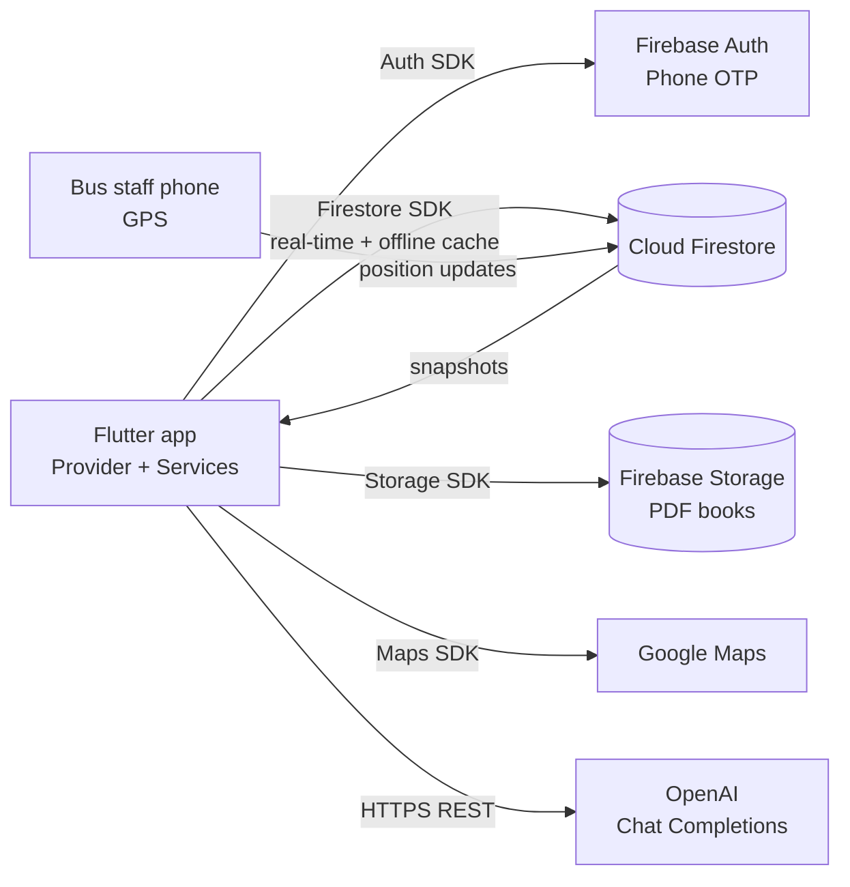
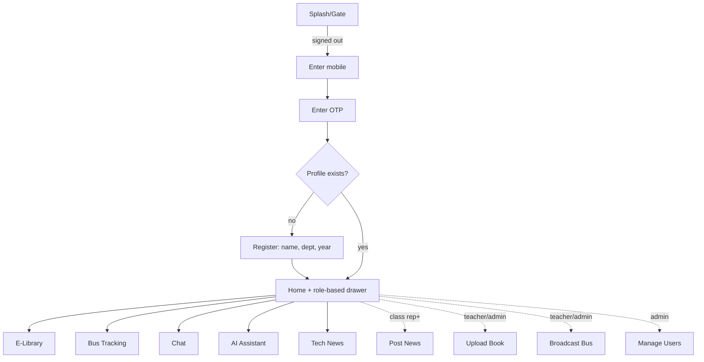

# E-Campus – Flutter College Management App
**Capstone Project – Mobile Computing (MCA Sem III, 2026-27), Aditya Institute of Management Technology and Research**

## Preliminary pages

- **Title page:** E-Campus – Flutter College Management App · Team: _<names, roll numbers (max 4)>_ · Guide: Dr. Girish Tere
- **Approval sheet:** _<to be signed by guide / HOD>_
- **Abstract:** E-Campus is a Flutter application that gives students, class representatives, teachers and administrators a single mobile platform for academic activities. It provides OTP-based login (Firebase Authentication), role-based access control, an e-library, live college-bus tracking on Google Maps, real-time chat, an AI doubt-solving chatbot (ChatGPT API) and department-wise tech news.
- **Acknowledgments:** _<to be written by the team>_
- **Table of contents:** Chapters 1–6 below.

---

## Chapter 1 – Introduction

**Background.** Colleges use separate tools for notices, study material, transport and communication. Students juggle WhatsApp groups, notice boards and PDFs, and nothing adapts to who the user is (student vs teacher vs admin).

**Objectives**
1. Single sign-in with the mobile number the student already owns (OTP).
2. Give each role only the features and data it needs (RBAC).
3. Provide study material, bus location, chat, AI help and news in one app.
4. Keep working on poor connectivity (Firestore offline cache).

**Scope.** Android/iOS app (Flutter), Firebase backend, Google Maps, OpenAI API. Single campus, single bus fleet, department-level segregation.

**Limitations.** Foreground-only bus broadcasting; AI key embedded in build (demo); no push notifications; no attendance/fees modules.

**Significance.** Reduces information scattering, gives students real-time bus visibility, and demonstrates mobile sensors (GPS), cloud integration and secure role design.

## Chapter 2 – Literature Review

| Existing solution | Strength | Gap addressed by E-Campus |
|---|---|---|
| Generic ERP portals (web-first) | Complete records | Poor mobile UX, no live bus, no chat |
| WhatsApp / Telegram groups | Fast communication | No roles, no moderation, material gets lost |
| Google Classroom | Course material | No transport, no department news, no AI helper |
| Uber-style tracking apps | Live location | Not tied to college identity/roles |

**Technologies:** Flutter/Dart (single codebase), Firebase Auth (phone OTP), Cloud Firestore (real-time sync + offline persistence), Firebase Storage, Google Maps SDK, Geolocator (GPS), REST/JSON to OpenAI Chat Completions, Provider (state management).

## Chapter 3 – System Design & Architecture

### 3.1 High-level architecture (client–server, BaaS)

Layers: **screens** (UI) → **providers** (session state) → **services** (Firebase/HTTP) → backend. Security rules in Firestore/Storage enforce RBAC even if the client is modified.

### 3.2 UI/UX flow

**Wireframes:** _<insert screenshots of: Login, OTP, Dashboard + drawer (student vs admin), Library, Bus map, Chat, AI, News>_

### 3.3 Role-based access matrix

| Capability | Student | Class Rep | Teacher | Admin |
|---|:-:|:-:|:-:|:-:|
| Library, bus map, chat, AI, news (own dept) | ✔ | ✔ | ✔ | ✔ (all depts) |
| Post tech news | | ✔ (own dept) | ✔ | ✔ |
| Upload / remove books | | | ✔ | ✔ |
| Broadcast bus location | | | ✔ | ✔ |
| Change user roles | | | | ✔ |

### 3.4 Database schema (Cloud Firestore)

| Collection / path | Fields |
|---|---|
| `users/{uid}` | name, department, year, role, createdAt |
| `books/{id}` | title, author, department (`ALL` or code), fileUrl, uploadedBy, createdAt |
| `news/{id}` | title, body, department, authorId, authorName, createdAt |
| `chats/{chatId}/messages/{id}` | senderId, senderName, text, createdAt — `chatId` = `uidA_uidB` (sorted) or `dept-<code>` |
| `bus_locations/{busId}` | lat, lng, speedKmh, driverName, updatedAt |

### 3.5 Network/API communication

- **Auth:** `verifyPhoneNumber` → SMS → `signInWithCredential`.
- **Data:** Firestore snapshot listeners (WebSocket-like streaming, local cache when offline).
- **Bus tracking:** publisher writes only after the device moves ≥ 20 m (battery/bandwidth saving); subscribers render markers; a bus silent for > 2 min is shown as "Last seen".
- **AI:** `POST https://api.openai.com/v1/chat/completions` with the last 20 turns, 45 s timeout, errors mapped to user-friendly messages.

## Chapter 4 – Implementation

**Environment:** Flutter 3.x / Dart 3.13, Android Studio or VS Code, Firebase project, Google Maps SDK for Android. Packages: `firebase_core`, `firebase_auth`, `cloud_firestore`, `firebase_storage`, `google_maps_flutter`, `geolocator`, `http`, `provider`, `url_launcher`, `file_picker`, `intl`.

**Core modules**

| Module | File(s) | Notes |
|---|---|---|
| Session & gate | `providers/session_provider.dart`, `app.dart` | Listens to auth state then the user's Firestore profile; routes to login / profile setup / home |
| OTP auth | `services/auth_service.dart`, `screens/auth_screen.dart` | Handles auto-retrieval, resend, error mapping |
| RBAC | `models/app_user.dart`, `screens/home_screen.dart`, `firestore.rules` | `UserRole` exposes capability getters; `drawerEntriesFor(role)` builds the drawer; rules enforce on the server |
| E-Library | `library_screen.dart`, `add_book_screen.dart` | PDF upload to Storage (≤ 25 MB) or link; search; open externally |
| Bus tracking | `bus_tracking_screen.dart`, `bus_sharing_screen.dart` | Google Maps markers; GPS stream with permission/GPS-off handling |
| Chat | `chat_list_screen.dart`, `chat_room_screen.dart`, `services/chat_ids.dart` | Rules derive access from the chat id |
| AI chatbot | `services/openai_service.dart`, `ai_chat_screen.dart` | Key via `--dart-define`; testable with injected HTTP client |
| Tech news | `news_screen.dart`, `post_news_screen.dart` | Department-scoped feed |

**Security decisions:** self-registration can only create `student`; role changes are admin-only and an admin cannot change their own role; phone numbers are not copied into Firestore (the directory shows names only).

## Chapter 5 – Testing & Evaluation

### 5.1 Automated tests (`flutter test`, 22 tests passing)

| Area | Cases |
|---|---|
| RBAC | Capabilities per role; unknown role → student |
| Drawer | Student sees 6 entries; class rep +Post News; teacher +Upload/Broadcast; admin sees all 10 |
| Models | Round-trip, missing fields tolerated |
| Chat IDs | Symmetric direct id; department room id |
| Bus | Live vs offline vs missing timestamp |
| OpenAI client | Request shape & auth header, missing key, API error, non-JSON body, empty choices, network failure |

`flutter analyze`: no issues.

### 5.2 Manual test cases (to execute on device)

| # | Scenario | Expected |
|---|---|---|
| T1 | Enter valid number, receive OTP, enter code | Signed in; profile form shown for new user |
| T2 | Wrong OTP | "Incorrect OTP" message, stays on screen |
| T3 | Register as student | Drawer shows 6 entries |
| T4 | Admin promotes user to Teacher | Drawer for that user gains Upload Book + Broadcast |
| T5 | Student tries to write `news` via a modified client | Denied by Firestore rules |
| T6 | Teacher uploads PDF; student opens it | Book listed and opens |
| T7 | Teacher starts broadcast; student opens map | Marker appears and moves |
| T8 | Stop broadcast | Marker disappears |
| T9 | Two users chat; third user opens same room id | Third user denied |
| T10 | Ask AI a question; then with no network | Answer shown; friendly error offline |
| T11 | Class rep posts news; student in same/other dept | Visible only in same dept |
| T12 | Airplane mode: open library/news/chat | Cached data shown; sent messages sync on reconnect |

### 5.3 User acceptance testing and performance

_To be completed by the team after device testing — record real measurements, do not estimate:_

| Metric | Method | Result |
|---|---|---|
| OTP delivery time | stopwatch, 10 trials | _TBD_ |
| Bus position latency (publisher → viewer) | timestamp diff, 10 samples | _TBD_ |
| AI response time | average of 10 prompts | _TBD_ |
| Battery drain while broadcasting (1 h) | Android battery stats | _TBD_ |
| Offline sync | airplane-mode scenario T12 | _TBD_ |
| UAT | 5–10 users, SUS questionnaire | _TBD_ |

## Chapter 6 – Conclusion & Future Work

**Achievements.** A working multi-role mobile platform covering OTP authentication, RBAC (client and server enforced), e-library, real-time bus tracking, chat, AI assistant and department news, with automated tests for the core logic.

**Constraints.** Foreground-only GPS publishing; OpenAI key in the client build; free-tier Firebase quotas; Android phone-auth requires SHA fingerprints and SMS availability.

**Future work.** Push notifications (FCM) for news/chat; background location service or a dedicated driver app; Cloud Function proxy for the AI key and per-user rate limits; attendance, timetable and fee modules; media/file sharing in chat; ETA estimation per bus stop; admin analytics dashboard.

## References

- Flutter documentation – https://docs.flutter.dev
- Firebase documentation (Auth, Firestore, Storage, Security Rules) – https://firebase.google.com/docs
- Google Maps Platform – https://developers.google.com/maps
- OpenAI API reference (Chat Completions) – https://platform.openai.com/docs
